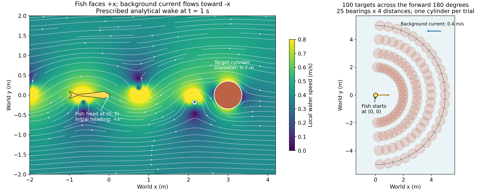
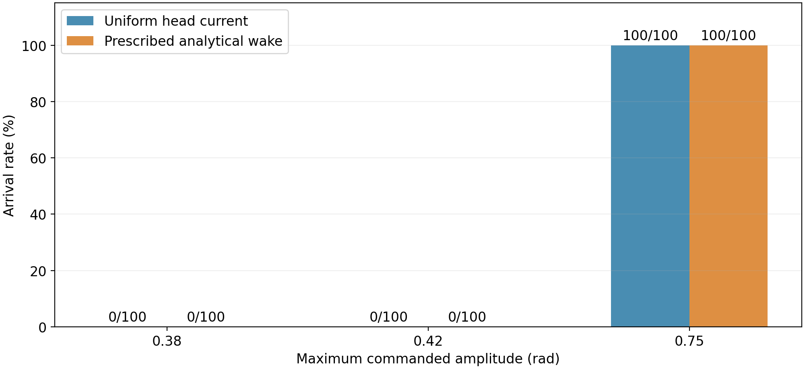

# Robot fish navigation in prescribed vortex wakes

This folder contains the curated MuJoCo fish models, the unmodified six-input PD controller, fixed navigation scenes, recorded results, and English research figures. The main closed-loop wake benchmark uses the **N4 fish with four actuated joints**. N3, N5, N6 and N8 XML models are included for future experiments.



## Reproduce the experiment

Python 3.8 or newer is required. Install `requirements.txt` in a virtual environment, then run commands from this folder:

```powershell
python verify_bundle.py
python experiments/front180_wake/check_coupling.py
python experiments/front180_wake/run.py --mode wake --cap 0.75
python experiments/front180_wake/run.py --mode uniform --cap 0.75
python experiments/front180_wake/summarize.py
python experiments/front180_wake/plot.py
python presentation/make_figures_en.py
```

Run both flow modes with `--cap 0.38`, `--cap 0.42`, and `--cap 0.75` to reproduce all six groups. The recorded CSVs, summaries and trajectories are already included. `verify_bundle.py` checks file hashes, morphology compilation, previous uniform-flow results and representative controller episodes. `check_coupling.py` separately compares the local-flow force correction with the installed MuJoCo fluid-force calculation.

## Environment and target definition

The fish head starts at `(0, 0, 0.5)` m and faces world `+x`. The background current is `(-0.4, 0, 0)` m/s. Twenty-five bearing bins cover the forward 180 degrees, with centers from `-86.4` to `+86.4` degrees including zero. Each bearing has four target distances: `2, 3, 4, 5` m. All 100 scenes have a strictly upstream component.

Each trial contains **one** cylinder at its target position. Its diameter is 0.7 m, height is 1 m and center is at z=0.5 m. The layout figure overlays all independent target positions. Fish-to-cylinder collision is enabled. Arrival occurs when the minimum 3D distance from the head geometry to the cylinder surface is at most 0.05 m, provided the same step has no physical failure. The trial limit is 60 s.

The PD input is `[head_x, head_y, yaw, yaw_rate, target_x, target_y]`. The controller estimates drift internally from position history. It receives no true water-velocity vector. Its outputs are `[raw_bias_B, amplitude_offset_delta_A]`. Frequency stays at 2.5 Hz. The base amplitude is `Amax - 0.1` rad and the controller chooses an offset of ±0.1 rad. Joint targets retain the original ±0.75 rad clamp. The previously measured 0.557 m/s still-water speed is an average speed, not an amplitude or a hard speed cap.

## Recorded arrival results

| Maximum commanded amplitude | Uniform head current | Prescribed analytical wake | Wake physical failures | Wake timeouts |
|---:|---:|---:|---:|---:|
| 0.38 rad | 0/100 | 0/100 | 3 | 97 |
| 0.42 rad | 0/100 | 0/100 | 1 | 99 |
| 0.75 rad | 100/100 | 100/100 | 0 | 0 |

At 0.75 rad, mean arrival times are 18.90 s in uniform flow and 17.30 s in the prescribed wake. These are paired results for this fixed suite. The low-amplitude results demonstrate failure under the fixed controller and time limit; a separate speed-envelope analysis would be needed to prove strict physical unreachability.



## What the wake model represents

`wake_preview.py` provides potential flow around a cylinder plus 12 alternating regularized vortices. The closed-loop benchmark rotates and translates that field to the upstream target cylinder. At each fish body center of mass, it samples local water velocity every 20 ms and adds the difference between local-flow and background-flow inertia-box drag. MuJoCo retains its native background and rotational drag. The uniform-flow force-difference check has a maximum generalized-force error of `4.44e-16` on the installed MuJoCo 3.2.3.

The prescribed initial vortex train convects downstream at 0.3 m/s. **It does not continuously shed new vortices.** The field does not solve Navier–Stokes equations or two-way fluid–structure interaction. Consequently, 100/100 applies to these prescribed analytical cases and does not establish success in arbitrary real wakes or multiple-obstacle environments. A 0.4 m/s background does not imply a 0.4 m/s local velocity everywhere.

## Folder guide

| Path | Contents |
|---|---|
| `flow_040_navigation/blind_6d.py` | Current six-input PD controller |
| `controllers/` | Earlier six-input heading-first baseline |
| `fish_morphologies/` | N3, N4, N5, N6 and N8 MuJoCo XMLs |
| `legacy_stack/` | Frozen environment and servo dependencies required by the current controller |
| `models/` | Standalone cylinder preparation model |
| `experiments/front180_wake/` | Main 100-scene benchmark, force coupling, six CSVs, summaries and trajectories |
| `experiments/upstream_cylinder_040/` | Earlier restricted-angle cylinder-region comparison |
| `structured_100_040/`, `structured_100_050/` | Earlier mixed-direction 0.4/0.5 m/s uniform-flow scenes |
| `reference_results/` | Earlier amplitude comparisons on mixed-direction scenes |
| `reference_cross_morph_hydro/`, `eel_swimming/` | Related morphology and hydrodynamics scripts |
| `presentation/figures_en/` | English plots and actual MuJoCo morphology renders |
| `presentation/` | Figure source, slide plan, presentation link and verified PDF export |
| `references/` | User-provided translated paper reference |
| `source_manifest.json` | SHA-256 integrity records for the portable bundle |

The XML declares head quaternion and velocity sensors. The body sites `s0…s7` are markers, not local-flow sensors. The current PD obtains position, orientation, yaw rate and goal from simulation state. The paper's body-frame target/flow/gradient observations are a different six-dimensional representation.

The existing research presentation is available at [Google Slides](https://docs.google.com/presentation/d/1X6HSrvL_L7XZjNDd2qv1a4vUSrzd37tSb2n5ljms0W0/edit). Slides 15–22 document the wake experiment in English.
