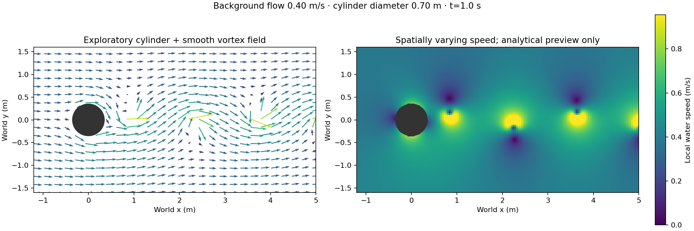

# 机械鱼圆柱尾流导航实验起点

项目路径：`D:\RobotFish_VortexWake_PD_Morphology_20261116`

按文件夹查看各部分及测试条件位置：[`DIRECTORY_GUIDE_zh.md`](DIRECTORY_GUIDE_zh.md)；机器可读的条件索引在 [`experiments/`](experiments/README_zh.md)。

本目录把原先分散在 `D:\EEL_MOJOCO` 和 `D:\Fish_Baseline_PD_and_SAC_20261028` 的**可运行 6D PD 基线**、原始 N=4 MuJoCo 环境依赖、五种形态的模型与生成/游动脚本，以及 0.4/0.5 m/s 配对测试数据集中到一起。原文件采用复制方式保留。每个复制文件的原路径、大小和 SHA-256 见 `source_manifest.json`。仅为解除旧目录的符号链接和路径深度，复制版的两个旧环境文件更改了内部相对路径；控制公式没有改。

## 目前可运行的部分

- `flow_040_navigation/blind_6d.py`：最近测试的 6D 闭环 PD 控制器。观测 `[fish_x,fish_y,yaw,yaw_rate,target_x,target_y]`；动作 `[raw_B,ΔA]`。它用历史位置估计漂移，不读取真实水流向量。
- `flow_040_navigation/blind_6d_benchmark.py`：100 场景基线测试。`flow_040_navigation/screen.py` 是此目录新增的本地环境适配器，让原测试脚本的导入指向本目录中的 `legacy_stack`。
- `controllers/flow_aware_8d.py` 与 `controllers/heading_first_6d.py`：保留已有的其他 PD 控制器版本供对照。`legacy_stack/01_Baseline_Controller/core.py` 与 `legacy_stack/05_PD_FishVelocity_Feedback/controller.py` 是旧 PD 波形/速度反馈来源。
- `legacy_stack/`：按原来的 02→03→04→06→07→12→13 链保存 13D 环境包装层、配置，以及 `1027_formal` 和 N=4 实体 XML。导航测试最终使用 13 环境的 `EvaluationEnv`，但只传 `obs[:6]` 给 6D PD。
- `fish_morphologies/`：`generate_fish.py`、`test_swim.py`、`fish_N3/4/5/6/8.xml`、原 20 s 扫描结果和步态参数；`eel_swimming/assets/` 放生成器所需的原场景和泳池视觉 XML。此形态扫描是**静水直游实验**，尚未与上述 N=4 导航 PD 直接组成五形态闭环测试。
- `reference_cross_morph_hydro/`：较大规模的多形态、水流与 Oracle Force 项目**源码参考快照**。其依赖 GPU、`mjlab`、PyTorch、Warp、其他 `fish_rl` 模块以及原训练 checkpoint；这里没有移入训练任务、checkpoint 和大体积运行记录，因此该目录不声称可独立运行完整训练管线。
- `structured_100_040/`、`structured_100_050/`：配对场景和协议。`reference_results/` 保存最近三档摆幅在两个水流速度下的逐场景 CSV 与汇总 JSON。

## 与论文的关系及现阶段边界

参考 PDF：`references/paper_zh_translation.pdf`，为用户提供的中文译本。文中研究的是均匀自由来流经过**固定圆柱**所形成的非定常尾流：一条路线是 IBAMR 求解的 Navier–Stokes/浸入边界 CFD；另一条是正负交替点涡构成的简化涡街。文中用局部流速及其**空间梯度**辅助自我中心导航，并比较不同尾流、雷诺数和流场旋转下的迁移能力。论文的“自我中心 6D”是目标的机体坐标相对位置、机体坐标流速及两个流速梯度分量，**不是本项目 `[x,y,yaw,yaw_rate,target_x,target_y]` 的 6D**。

本项目现有 MuJoCo 环境中的 `model.opt.wind` 是**全域相同**的水流向量；已有鱼体 geom 的 `contype=0, conaffinity=0`，无碰撞响应。因此仅向 XML 增加一个圆柱实体，既不会让 `opt.wind` 自动产生圆柱尾流，也不会让当前鱼体与圆柱碰撞。这是 MuJoCo 本体设置的事实，不能将“看见一个柱体”当成论文所用流体计算。

`wake_preview.py` 提供了一个可采样的二维**运动学预览场**：背景均匀流、绕圆柱势流项和带有限核心的交替涡旋之和；有 `velocity(x,y,t)` 和数值 `gradient(x,y,t)` 接口。它仅用于确定坐标、尺度、流速/梯度观测与可视化，**尚未接入鱼体受力**，并非论文的 CFD 解、精确 VS 公式或到达率结果。对应图片为 `wake_field_preview.png`。

`make_cylinder_control.py` 已生成 `models/fish_N4_cylinder_only.xml` 作为“只加固定圆柱”的对照模型。模型能被 MuJoCo 加载，但检查结果仍是单个全域 `wind=(0.4,0,0)`，鱼体碰撞标志仍为零。这明确展示了只加实体在现有设置下不会产生尾流，也不会形成有效绕障碰撞实验。



真正的下一阶段需要：

1. 选定圆柱直径、来流速度、鱼/目标相对圆柱的位置，并固定成可配对场景。把圆柱加入 MuJoCo 几何；若需要碰撞，还要检查并启用鱼体相应接触设置。
2. 选定**经校验**的局部流场来源：论文式 CFD 数据插值，或其经过正则化的解析涡街。对鱼的各体段在当前世界坐标和时刻采样 `u(x_i,t)`，将相对流速造成的水动力以一致的力/力矩方式接入 MuJoCo；不能用一个全域 `opt.wind` 向量代替空间尾流，也不能把相同阻力算两次。
3. 先比较“无圆柱均匀流、只有圆柱几何、圆柱加空间尾流”的物理作用，再比较当前 6D PD、流速输入版及流速梯度输入版。需分别报告碰撞、出界、超时、到达率和轨迹，避免将控制器变化与流场变化混为一谈。

## 运行基线

在已安装 `numpy`、`mujoco`、`gymnasium`、`matplotlib` 的 Python 环境中：

```powershell
cd D:\RobotFish_VortexWake_PD_Morphology_20261116
python verify_bundle.py
python flow_040_navigation/blind_6d_benchmark.py --scene-file structured_100_040/scenes.json --frequency-hz 2.5 --max-amplitude 0.75 --prefix baseline_040_a075
python flow_040_navigation/blind_6d_benchmark.py --scene-file structured_100_050/scenes.json --frequency-hz 2.5 --max-amplitude 0.75 --prefix baseline_050_a075
python fish_morphologies/test_swim.py --pilot --n 3 4 5 6 8 --no-render
python make_cylinder_control.py --flow 0.4 --diameter 0.7
python wake_preview.py --flow 0.4 --diameter 0.7 --time 1.0
```

`baseline_...` 输出到 `flow_040_navigation/`，不会覆盖 `reference_results/`。五形态 `--pilot` 是单一参数的机制烟雾测试，不是原 45 组合正式扫描；正式扫描是 `python fish_morphologies/test_swim.py --no-render`。如需重建 XML，可运行 `python fish_morphologies/generate_fish.py`，但会覆盖本目录已复制的 XML，建议先保留源清单。

本目录中已验证的 0.4 m/s 到达数依次为最大摆幅 0.75/0.42/0.38 rad 的 `100/21/17`（每组 100 场）；0.5 m/s 为 `34/13/7`。尾摆频率都是 2.5 Hz。这些是**均匀流、无障碍**结果，不可标注为涡流结果。
