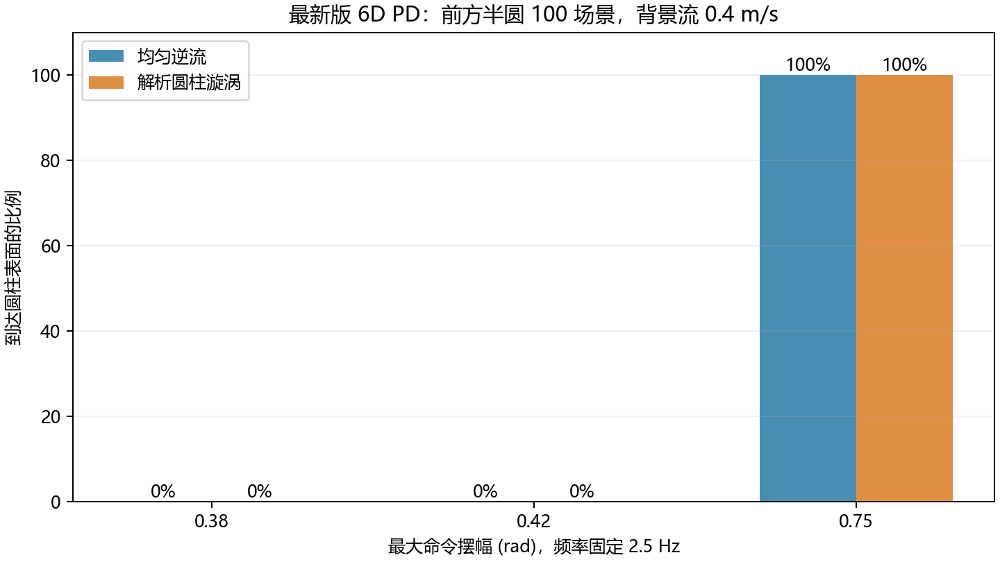
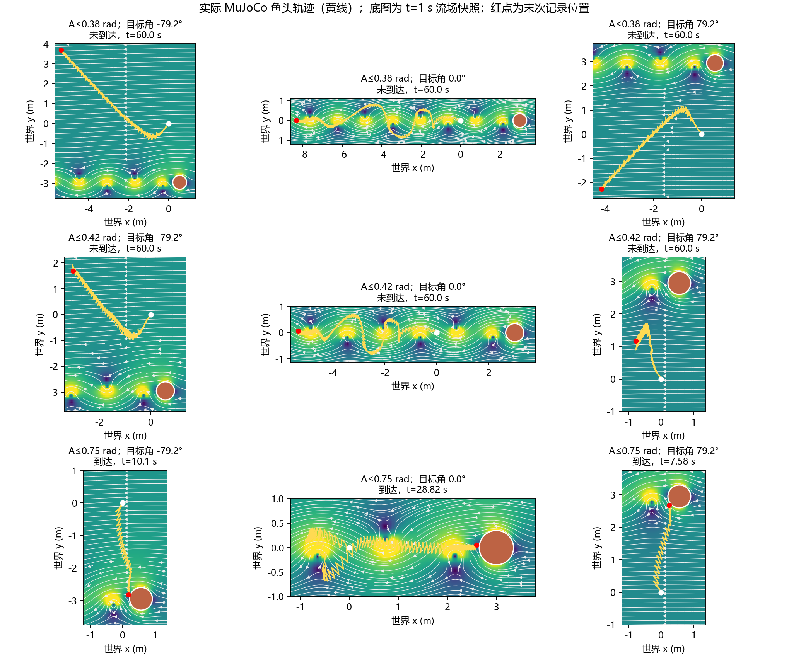

# 实测结果

| 最大命令摆幅 rad | 均匀逆流到达 | 解析漩涡到达 | 均匀/漩涡物理失效 | 均匀/漩涡超时 |
|---:|---:|---:|---:|---:|
| 0.38 | 0/100 | 0/100 | 0/3 | 100/97 |
| 0.42 | 0/100 | 0/100 | 0/1 | 100/99 |
| 0.75 | 100/100 | 100/100 | 0/0 | 0/0 |

最大档 0.75 rad：均匀流平均到达时间 18.90 s，解析漩涡平均 17.30 s。两种低摆幅是否存在严格物理不可达，需要额外的速度包络与可达性分析；本表只证明它们在本次固定 PD、时限与场景下未到达。

100/100 是这 100 个规定解析流场场景的结果，不代表真实持续脱涡流场或任意多障碍场景的保证。
