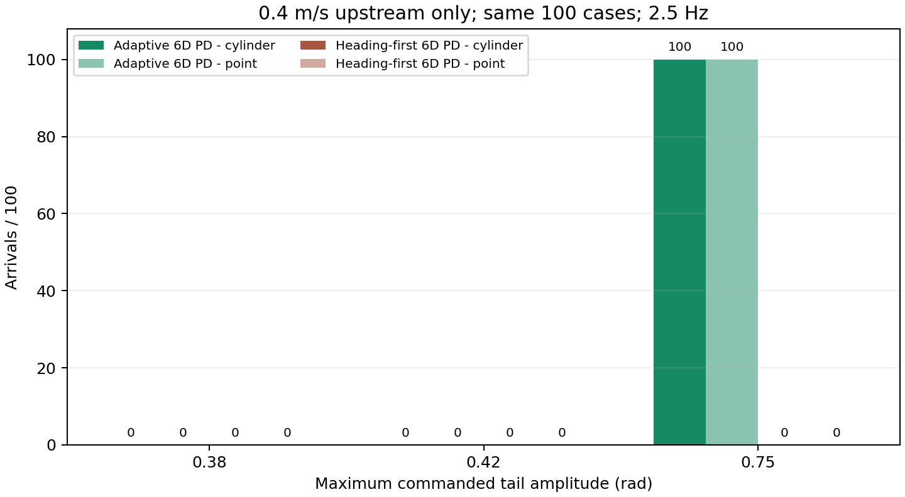
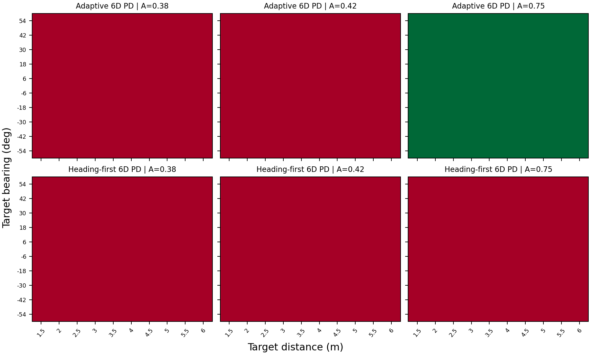

# 0.4 m/s 逆流圆柱目标实验

## 场景与判据

运行 `python make_scenes.py` 固定生成 `scenes.json` 的 100 个场景。鱼头从 `(0,0,0.5)` 出发，初始航向为世界 `+x`，均匀水流为 `(-0.4,0,0) m/s`。目标距离取 1.5、2.0、…、6.0 m，目标相对初始航向取 `-54,-42,-30,-18,-6,+6,+18,+30,+42,+54` 度，构成 10×10 的配对网格。每个目标的 x 坐标均为正，目标方向与流速内积严格小于零，故没有顺流目标。带符号的水流相对目标方向为 126° 至 234°；两个向量的无符号夹角不可能超过 180°。

目标在实际编译的 MuJoCo 模型中是半径 0.35 m、高 1.0 m、中心 z=0.5 m 的非碰撞圆柱 geom。**到达定义**：鱼头首次进入圆柱，即 XY 距离 ≤0.35 m 且 `|z-0.5|≤0.5 m`，该步无物理失效。为和旧测试对比，同次轨迹还记录首次进入 XY 距离 `<0.30 m` 的点目标。没有要求整条鱼穿过圆柱、停留或触碰实体；圆柱只是目标区域，不是障碍物或涡旋发生器。

每次最多 60 s，控制步长 0.02 s，摆尾频率固定 2.5 Hz，采用相同初态与场景；最大命令摆幅分为 0.38、0.42、0.75 rad。控制器是 `flow_040_navigation/blind_6d.py`（现行带内部漂移估计的 6D PD）和 `controllers/heading_first_6d.py`（旧版航向优先 6D PD）。二者都只接收六个观测数，不直接读取流速。水流只由环境施加。0.557 m/s 是先前 0.75 rad、2.5 Hz **静水平均直游速度**，既不是振幅值，也不是瞬时速度硬上限。本实验没有开启涡旋、障碍碰撞或局部 CFD 流场。

## 结果（每格 100 个场景）

| 控制器 | 最大命令摆幅 rad | 圆柱到达 | 旧点目标到达 | 物理失效 | 超时 |
|---|---:|---:|---:|---:|---:|
| 现行 6D PD（内部漂移估计） | 0.38 | 0/100 | 0/100 | 0 | 100 |
| 现行 6D PD（内部漂移估计） | 0.42 | 0/100 | 0/100 | 0 | 100 |
| 现行 6D PD（内部漂移估计） | 0.75 | **100/100** | **100/100** | 0 | 0 |
| 旧版航向优先 6D PD | 0.38 | 0/100 | 0/100 | 40 | 60 |
| 旧版航向优先 6D PD | 0.42 | 0/100 | 0/100 | 20 | 80 |
| 旧版航向优先 6D PD | 0.75 | 0/100 | 0/100 | 0 | 100 |

0.38/0.42 rad 现行 PD 的平均最接近目标的进展分别为 0.023/0.043 m；旧版 0.75 rad 的平均进展约 0.498 m。这说明在**这组固定模型与场景**里，低摆幅时主要没有足够逆流位移；旧版即使增大摆幅也未到达，控制方向策略同样重要。平均进展只是轨迹的最近距离统计，不能单独当作鱼的最大游速。上述 100/100 也不代表任意水流方向、任意障碍或真实涡旋下的保证。





## 现行 PD 的六维输入与控制

每步输入 `o_t=[x_t,y_t,ψ_t,r_t,x_g,y_g]`，分别是鱼头世界 XY、鱼头航向、偏航角速度、目标中心世界 XY。`x,y,ψ,r` 来自 MuJoCo 状态，目标来自场景配置；这是仿真可观测状态，并不等于 XML 中已经装好了六个真实传感器。控制器每步输出 `a_t=[B_raw,t, ΔA_t]`。流速真值不在输入中。

记 `wrap` 为映射到 `[-π,π)`，`clip(v,l,h)` 为截断。主要计算为：

```text
ψ̂_t = wrap(ψ̂_(t-1) + 0.1 wrap(ψ_t-ψ̂_(t-1)))
r̂_t = 0.9 r̂_(t-1) + 0.1 r_t
v_ground,t = (p_t-p_(t-1))/0.02
v_res,t = v_ground,t - 0.54 [cos ψ_t, sin ψ_t]
f̂_t = clip((1-α)f̂_(t-1)+α v_res,t, -0.6, 0.6), α=0.02/1.02
u = (g-p_0)/||g-p_0||, n=[-u_y,u_x]
e_cross,t=(p_t-p_0)·n
I_t=clip(I_(t-1)+0.02 e_cross,t,-8,8)
c_t=clip(e_cross,t+0.3 I_t,-1.4,1.4)
ψ_des,t=wrap(atan2((0.4u-0.5f̂_t)_y,(0.4u-0.5f̂_t)_x)-c_t)
e_ψ,t=wrap(ψ_des,t-ψ̂_t)
B_raw,t=-clip(0.4 e_ψ,t,-0.3,0.3), ΔA_t=+0.1
```

流速估计从第 21 步以后、非原地转向时更新。`v_res` 是按假定游速 0.54 m/s 得到的**漂移残差估计**，不是真实流速传感器读数。若目标方向误差超过 1.4 rad，则进入转向模式，`B_raw=-0.3 sign(e_target)`、`ΔA=-0.1`；误差回落至 0.65 rad 以下退出。距离目标小于 1 m 后改用 `ψ_des=atan2((0.35 d-f̂)_y,(0.35 d-f̂)_x)`，其中 `d=(g-p)/||g-p||`，`B_raw=-clip(0.5 e_ψ-0.08 r̂,-0.3,0.3)`，转角大时 `ΔA=-0.1`，否则 `+0.1`。

执行器进一步计算 `B_t=0.5B_(t-1)+0.5B_raw,t`，`A_t=A_base+ΔA_t`，四个关节按相位滞后的正弦波摆动，再把目标关节角截断到 ±0.75 rad。本实验现行 PD 设 `A_base=A_max-0.1`，所以转向时 `A_max-0.2`、直游时 `A_max`。旧版设 `A_base=A_max-0.05`，因为它的直游 `ΔA=+0.05`；两者有相同最大命令档，但转向时的摆幅曲线并不完全相同。

## 传感器与论文的对应关系

`fish_morphologies/fish_N4.xml` 实际声明 `head_imu` site、`head_quat`（framequat）、`head_velocity`（velocimeter）；`s0…s7` 是沿鱼身的 site **标记**，没有绑定流速或压力传感器。当前 6D PD 没有从 XML 读取水流或流速梯度。论文《Learning autonomous underwater navigation requires sensing flow gradients》研究的是**仿真游泳体**：自我中心输入是体坐标目标位移 `(Δx_b,Δy_b)`、局部流速 `(u_b,v_b)`，再加横向或纵向的两个局部流速梯度分量；动作是航向角速度 `Ω`。论文提出多点流速感知可用来估计梯度，但没有给这条 MuJoCo 鱼指定可直接照搬的物理传感器品牌或 XML 配置。它的“6D”与本项目的六维 `[x,y,ψ,r,x_g,y_g]` 不是同一组量。

若要在鱼的图像和仿真里展示论文式传感器，可在鱼头或体侧的 `s0…s7` 测点绘制局部流速箭头，使用两侧或前后测点的速度差估计梯度：`∂u_b/∂n≈(u_b,+−u_b,−)/d`，`∂v_b/∂n≈(v_b,+−v_b,−)/d`。先要有每个测点的**局部流场模型**；当前统一的 `model.opt.wind` 在所有位置相同，按这个场计算的空间梯度恒为零，因此无法开展论文的涡旋梯度实验。可在涡旋流场接口实现后，把六个论文式观测送给 RL 策略，再把策略输出定义为 `[B_raw,ΔA]` 并训练；论文的 `Ω` 策略权重不能直接控制这条鱼。

## 复现与文件

```powershell
python make_scenes.py
python run_benchmark.py --controller blind_6d --cap 0.75
python run_benchmark.py --controller heading_first_6d --cap 0.75
python plot_results.py
```

三档摆幅各运行一次。`protocol.json` 固定规则；`scenes.json` 固定 100 个初态；六个 CSV 是逐场原始结果，六个 `_summary.json` 是汇总；两张 PNG 分别为计数图与角度 × 距离图。运行器用 SHA-256 记录场景文件版本。新的圆柱是非碰撞目标，因此没有在鱼动力学中额外引入涡流或阻力。
